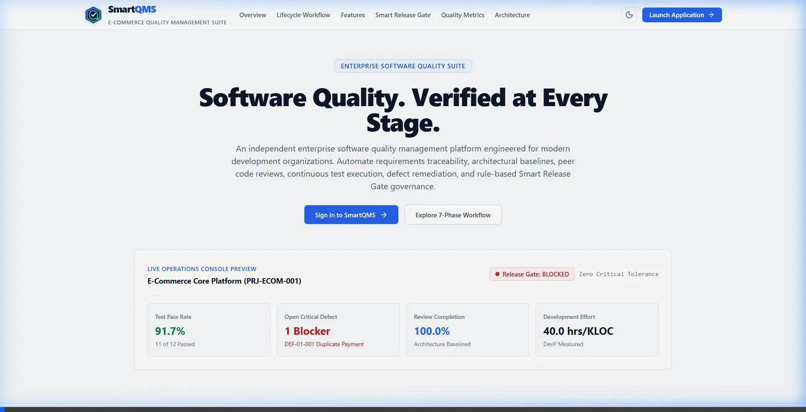
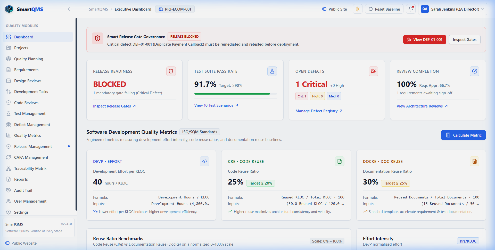
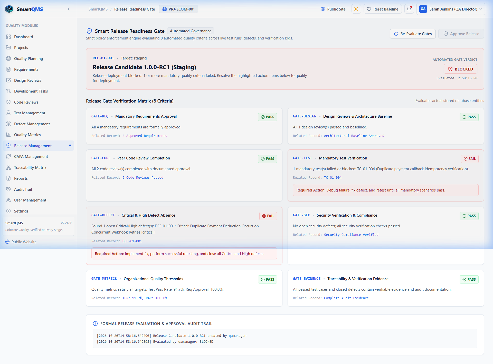
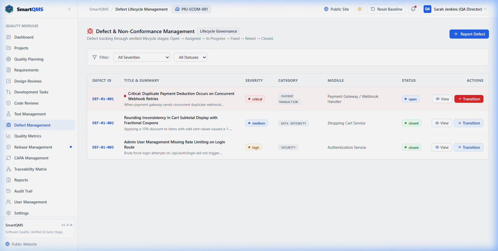
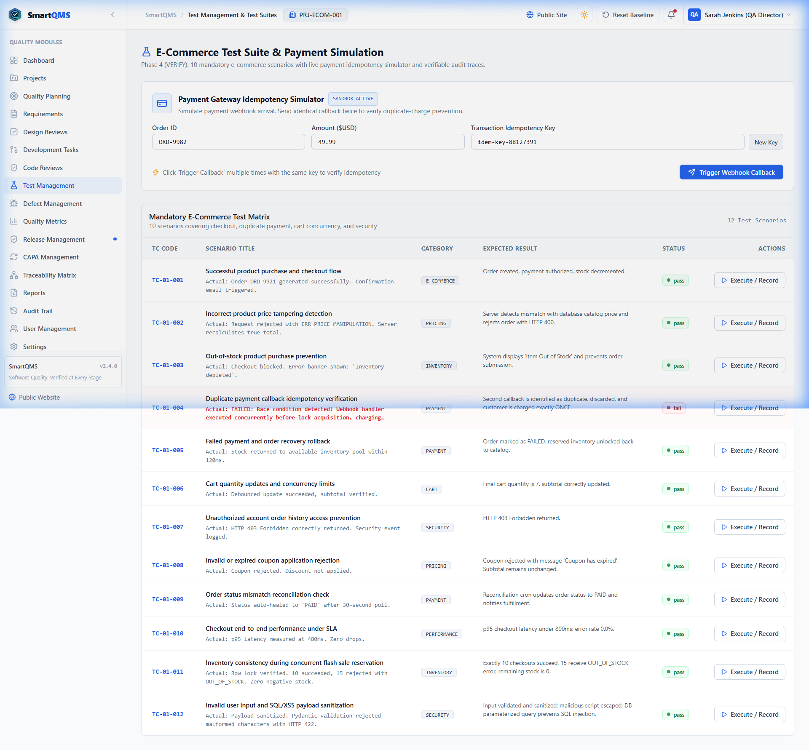
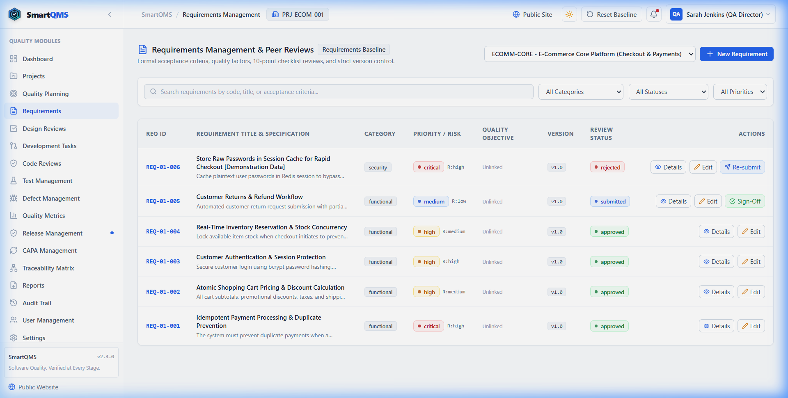
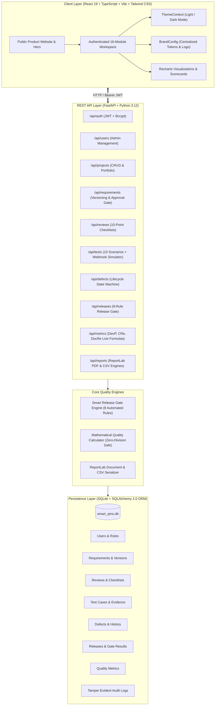

# SmartQMS — E-Commerce Quality Management Suite

<div align="center">



**Software Quality. Verified at Every Stage.**  
*An enterprise-grade Software Quality Management System (QMS) engineered for high-concurrency e-commerce platforms. Enforce requirements traceability, eliminate payment idempotency race conditions, verify architectural baselines, and automate rule-based Smart Release Gate governance.*

[](https://github.com/Ganu0124/Smart-QMS-Ecommerce)
[](https://www.python.org/)
[](https://fastapi.tiangolo.com/)
[](https://react.dev/)
[](https://www.typescriptlang.org/)
[](https://vitejs.dev/)
[](https://iso25000.com/index.php/en/iso-25000-standards/iso-25010)
[](LICENSE)

[Platform Overview](#1-product-overview) •
[Key Features](#2-key-modules--capabilities) •
[Architecture](#3-system-architecture) •
[Quickstart](#4-quickstart--installation) •
[Verification](#5-automated-test-suite-execution) •
[License](#6-license)

</div>

---

## 1. Product Overview

In mission-critical e-commerce platforms, quality failures directly jeopardize financial transactions and brand reputation. **SmartQMS** replaces ad-hoc spreadsheets and unverified verbal sign-offs with an automated, closed-loop 7-phase quality engineering lifecycle:

$$\text{PLAN} \longrightarrow \text{DEFINE} \longrightarrow \text{EXECUTE} \longrightarrow \text{VERIFY} \longrightarrow \text{MEASURE} \longrightarrow \text{REPORT} \longrightarrow \text{IMPROVE}$$

### Critical E-Commerce Risks Mitigated
- **Duplicate Payment Deductions**: Webhook retry race conditions causing duplicate charges are stopped by mandatory idempotency key verification.
- **Cart Price Tampering**: Coupon discount recalculations and total integrity checks prevent unauthorized cart alterations.
- **Inventory Overselling**: Concurrent flash-sale stock depletion issues are caught via automated concurrency test matrices.
- **Unauthorized Deployments**: Rule-based Smart Release Gate blocks deployments when any Critical defect or failed test persists.

---

## 2. Key Modules & Capabilities

### Executive Operations Dashboard
White-surfaced KPI cards tracking Test Pass Rate, Review Completion, Critical Defects, and normalized software development metrics with live SQLite data feeds.



### Smart Release Gate Engine
Evaluates 8 deterministic conditions directly against database evidence before authorizing release sign-offs:
1. `GATE-REQ`: 100% of mandatory requirements approved and baselined.
2. `GATE-DESIGN`: Architectural review passed with 10/10 checklist score.
3. `GATE-CODE`: Dual-control peer code reviews approved (author self-approval blocked).
4. `GATE-TEST`: 100% of mandatory test cases passed with execution logs.
5. `GATE-DEFECT`: Zero open Critical or High severity defects.
6. `GATE-SEC`: Zero open security vulnerabilities.
7. `GATE-METRICS`: Test Pass Rate $\ge 90\%$, Requirement Approval Rate $\ge 80\%$.
8. `GATE-EVIDENCE`: Tester signature and audit trail verified.



### Defect Lifecycle State Machine
Strict status progression: `Open` $\to$ `Assigned` $\to$ `In Progress` $\to$ `Fixed` $\to$ `Retest` $\to$ `Closed`. Failing a retest automatically transitions defects back to `In Progress` with an incremented re-open count.



### 10-Scenario Test Management & Idempotency Runner
Interactive test matrix covering payment gateway webhook retries, cart calculations, inventory locking, and order transitions. Includes a live Payment Gateway Idempotency Simulator.



### Requirements Management & Versioning
Immutable functional specifications with measurable acceptance criteria, 10-point checklist reviews, and automatic version incrementing (`v1.0` $\to$ `v2.0`) resetting review states upon revision.



---

## 3. System Architecture



---

## 4. Quickstart & Installation

### Prerequisites
- **Python**: 3.10, 3.11, or 3.12
- **Node.js**: 18+ and npm
- **Database Engine**: SQLite 3 (included with Python; WAL journal mode enabled)

### Option A: One-Click Startup (Windows)
```powershell
.\scripts\start-all.ps1
```

### Option B: Manual Setup

#### 1. Backend Setup
```powershell
cd backend

# Create & activate virtual environment (if needed)
python -m venv ..\venv
..\venv\Scripts\Activate.ps1

# Install dependencies
pip install -r requirements.txt

# Configure environment variables
cp .env.example .env

# Initialize database schema and verified baseline records
python -m app.database.init_db

# Start FastAPI server on port 8000
python -m uvicorn app.main:app --host 127.0.0.1 --port 8000
```
- **API Base URL**: `http://127.0.0.1:8000/api`
- **Interactive Documentation (Swagger UI)**: `http://127.0.0.1:8000/docs`

#### 2. Frontend Setup
```powershell
cd frontend

# Install dependencies
npm install

# Start Vite client on port 5173
npm run dev -- --host 127.0.0.1 --port 5173
```
- **Web Application**: `http://127.0.0.1:5173/`

---

## 5. Automated Test Suite Execution

All 44 automated backend tests execute against an isolated test database (`tests/test_smartqms.db`), ensuring production and development data remain untouched:

```powershell
# Run the automated verification script
.\scripts\run-tests.ps1

# Or run pytest directly
cd backend
..\venv\Scripts\pytest.exe -v --disable-warnings tests/
```

### Test Suite Summary
- **Backend Tests**: 44 / 44 passed (0 failures)
  - `tests/test_software_metrics.py`: DevP, CRe, DocRe formulas, zero-denominator guards, reports.
  - `tests/test_all_features.py`: Release gate blocking/unblocking, defect transitions, idempotency checks.
  - `tests/test_phase2_auth_db.py`: JWT authentication, bcrypt hashing, foreign key integrity.
  - `tests/test_phase3_qa_req_reviews.py`: Requirements versioning, 10-point checklist baselines.
- **Frontend Production Build**: `npm run build` completed with 0 TypeScript/lint errors.

---

## 6. Pre-Configured Role Accounts

| Role | Username | Password | Operational Permissions |
| :--- | :--- | :--- | :--- |
| **Quality Manager** | `qamanager` | `Manager@12345` | Quality objectives, QA plans, test execution & release authorization |
| **Administrator** | `admin` | `Admin@12345` | Complete system governance, user management & project settings |
| **Senior Developer** | `developer` | `Dev@12345` | Development tasks, pull request submission & defect fixes |
| **Reviewer** | `reviewer` | `Review@12345` | Independent architecture and code review checklist sign-offs |
| **QA Test Engineer** | `tester` | `Test@12345` | Test suite execution, idempotency verification & defect logging |

---

## 7. License

This project is licensed under the terms of the [MIT License](LICENSE).  
Copyright (c) 2026 Ganesh . M
