# SmartQMS System Architecture

## 1. Architectural Philosophy & Overview

**SmartQMS** (Software Quality Management System) is an enterprise SaaS platform engineered for high-concurrency e-commerce environments where unverified deployments lead directly to financial loss (duplicate payments, price tampering, stock overselling).

The system follows a strict three-tier architecture:
1. **Frontend Presentation Layer**: Built on React 19, TypeScript, and Tailwind CSS.
2. **Backend Application Layer**: FastAPI (Python 3.12) REST API with asynchronous request handlers, Pydantic data validation, and modular quality engines.
3. **Database Layer**: SQLite with Write-Ahead Logging (WAL) and foreign key constraints enabled via SQLAlchemy 2.0 ORM.

---

## 2. Component Hierarchy Diagram

```mermaid
graph TD
    subgraph Frontend ["Presentation Tier (React 19 + TypeScript + Vite)"]
        UI_Landing["Public Overview & Product Showcase"]
        UI_Auth["Authentication & Role Switcher"]
        UI_Dash["Executive Dashboard & KPIs"]
        UI_Gate["Smart Release Gate Console"]
        UI_Trace["Bidirectional Traceability Grid"]
        UI_Defects["Defect State Machine Interface"]
        UI_Tests["10-Scenario Test Runner"]
    end

    subgraph API_Gateway ["API Routing Tier (FastAPI)"]
        R_Auth["/api/auth"]
        R_Projects["/api/projects"]
        R_Reqs["/api/requirements"]
        R_Reviews["/api/reviews"]
        R_Tasks["/api/tasks"]
        R_Tests["/api/tests"]
        R_Defects["/api/defects"]
        R_Releases["/api/releases"]
        R_Metrics["/api/metrics"]
        R_CAPA["/api/capa"]
        R_Reports["/api/reports"]
    end

    subgraph Core_Engines ["Core Quality Services"]
        E_Gate["Smart Release Gate Engine (8 Rules)"]
        E_Metrics["Software Metrics Calculator (DevP, CRe, DocRe)"]
        E_Reports["ReportLab PDF & CSV Generator"]
        E_Audit["21 CFR Part 11 Audit Logger"]
    end

    subgraph Storage ["Persistence Tier (SQLAlchemy 2.0 + SQLite)"]
        T_Users["users"]
        T_Projects["projects"]
        T_Reqs["requirements & versions"]
        T_Reviews["reviews & checklists"]
        T_Tasks["development_tasks"]
        T_Tests["test_cases & steps"]
        T_Defects["defects & history"]
        T_Releases["releases & gate_evaluations"]
        T_Audit["audit_logs (Immutable)"]
    end

    Frontend <==>|JSON / Bearer JWT| API_Gateway
    API_Gateway --> Core_Engines
    Core_Engines --> Storage
```

---

## 3. Data Flow & Security Model

### Authentication & Authorization
- **JWT Authentication**: Passwords hashed with Bcrypt (salt rounds $\ge 12$). Access tokens issued as standard Bearer JWTs with 8-hour expiry.
- **Role-Based Access Control (RBAC)**: Fine-grained permissions enforced across 5 roles:
  1. `Administrator`: Complete system governance, project configuration, user administration.
  2. `Quality Manager`: Objective definition, QA planning, test oversight, release gate authorization.
  3. `Developer`: Development task execution, PR submission, defect fixes. (Self-approval strictly blocked).
  4. `Reviewer`: Independent design and code review checklist execution.
  5. `Tester`: Test case execution, automated verification, defect filing and retesting.

---

## 4. Key Engineering Engines

### 1. Smart Release Gate Engine (`app/services/gate_engine.py`)
Evaluates 8 deterministic conditions directly against database state:
- `GATE-REQ`: 100% of mandatory requirements must be approved.
- `GATE-DESIGN`: Architectural review baselined with 10/10 checklist passes.
- `GATE-CODE`: Peer code reviews approved with dual-control (developer cannot approve own PR).
- `GATE-TEST`: 100% mandatory test scenarios passed with execution evidence.
- `GATE-DEFECT`: Zero open Critical or High defects (Zero Tolerance).
- `GATE-SEC`: Zero open security vulnerabilities.
- `GATE-METRICS`: Test Pass Rate $\ge 90\%$, Requirement Approval Rate $\ge 80\%$.
- `GATE-EVIDENCE`: Tester signature and audit trail verified.

### 2. Software Development Metrics Engine (`app/services/metrics.py`)
Computes normalized software development metrics with zero-denominator safety guards:
- **Development Productivity (DevP)**: $\text{DevP} = \frac{\text{Development Hours}}{\text{KLOC}}$ (Baseline: 40.0 hrs/KLOC).
- **Code Reuse Ratio (CRe)**: $\text{CRe} = \left(\frac{\text{Reused KLOC}}{\text{Total KLOC}}\right) \times 100$ (Baseline: 25.0%).
- **Documentation Reuse Ratio (DocRe)**: $\text{DocRe} = \left(\frac{\text{Reused Documents}}{\text{Total Documents}}\right) \times 100$ (Baseline: 30.0%).
