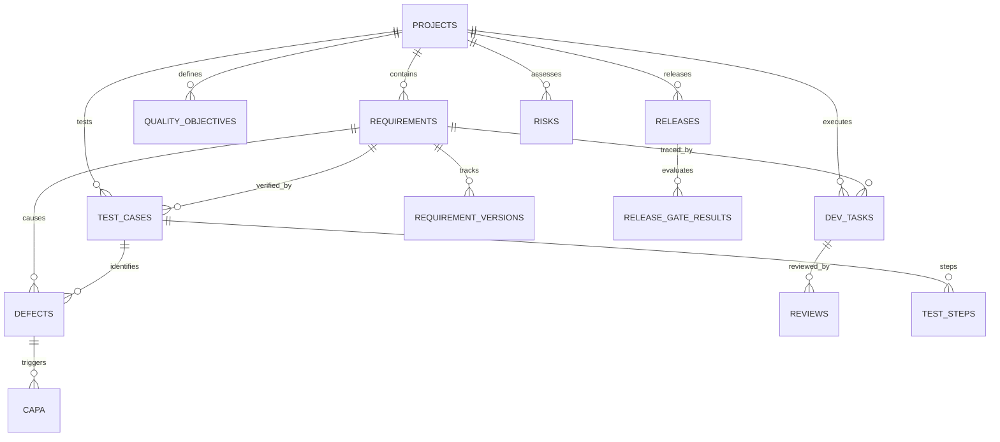

# SmartQMS Database Schema Documentation

## 1. Overview

The SmartQMS database is managed by SQLAlchemy 2.0 ORM with SQLite (WAL mode). Foreign keys are enabled on connection initialization.

---

## 2. Entity Relationship Diagram

---

## 3. Core Tables Reference

### `projects`
- `id` (INTEGER, PK): Auto-incrementing project ID.
- `project_code` (VARCHAR, UNIQUE): Unique identifier (e.g., `PRJ-ECOM-001`).
- `name` (VARCHAR): Project name.
- `description` (TEXT): Charter and scope description.
- `status` (VARCHAR): `active`, `planning`, `completed`, `archived`.
- `target_release_date` (DATETIME): Scheduled deployment window.

### `requirements` & `requirement_versions`
- `id` (INTEGER, PK): Primary key.
- `req_code` (VARCHAR, UNIQUE): e.g., `REQ-ECOM-001`.
- `title` (VARCHAR): Requirement title.
- `acceptance_criteria` (TEXT): Specific testable verification conditions.
- `priority` (VARCHAR): `critical`, `high`, `medium`, `low`.
- `status` (VARCHAR): `draft`, `submitted`, `approved`, `rejected`, `baselined`.
- `version` (VARCHAR): Incremented upon modification of approved specs (`1.0` $\to$ `2.0`).

### `reviews` (Design & Code Reviews)
- `id` (INTEGER, PK): Primary key.
- `review_code` (VARCHAR, UNIQUE): e.g., `REV-DES-001`, `REV-CODE-001`.
- `review_type` (VARCHAR): `design` (Architecture) or `code` (Peer PR).
- `checklist_scores` (JSON): 10-point checklist status mapping.
- `author_id` (INTEGER): User submitting review.
- `reviewer_id` (INTEGER): Independent reviewer (cannot equal author).
- `status` (VARCHAR): `pending`, `approved`, `rejected`, `baselined`.

### `test_cases` & `test_steps`
- `id` (INTEGER, PK): Primary key.
- `tc_code` (VARCHAR, UNIQUE): e.g., `TC-01-004`.
- `scenario_title` (VARCHAR): Verification scenario.
- `is_mandatory` (BOOLEAN): Release gate requirement.
- `status` (VARCHAR): `passed`, `failed`, `blocked`, `pending`.
- `execution_evidence` (TEXT): Logs, payload snippets, idempotency keys.

### `defects`
- `id` (INTEGER, PK): Primary key.
- `defect_code` (VARCHAR, UNIQUE): e.g., `DEF-01-001`.
- `title` (VARCHAR): Defect description.
- `severity` (VARCHAR): `critical`, `high`, `medium`, `low`.
- `status` (VARCHAR): `Open` $\to$ `Assigned` $\to$ `In Progress` $\to$ `Fixed` $\to$ `Retest` $\to$ `Closed`.
- `root_cause_category` (VARCHAR): e.g., `concurrency_race_condition`.

### `releases` & `release_gate_evaluations`
- `id` (INTEGER, PK): Primary key.
- `release_code` (VARCHAR, UNIQUE): e.g., `REL-1.0.0-RC1`.
- `status` (VARCHAR): `blocked`, `approved`, `deployed`, `aborted`.
- `gate_rules_snapshot` (JSON): Detailed pass/fail evaluation of 8 gate checks.

### `audit_logs` (21 CFR Part 11 Compliant)
- `id` (INTEGER, PK): Primary key.
- `timestamp` (DATETIME): UTC timestamp.
- `username` (VARCHAR): Responsible user.
- `action` (VARCHAR): `CREATE`, `UPDATE`, `APPROVED`, `REJECTED`, `BASELINED`, `RELEASE_APPROVAL`.
- `entity_type` (VARCHAR): Affected entity name.
- `entity_id` (VARCHAR): Entity code.
- `change_details` (TEXT): Immutable change log.
